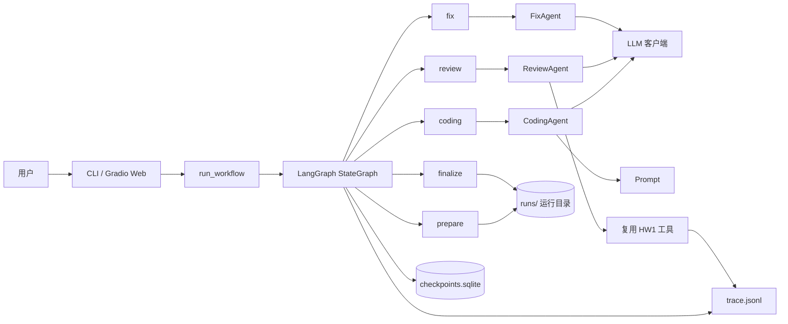
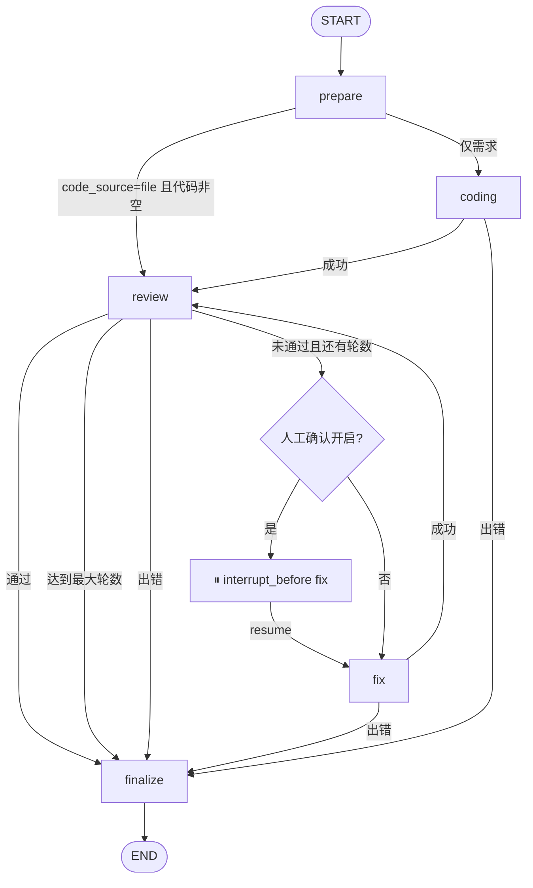
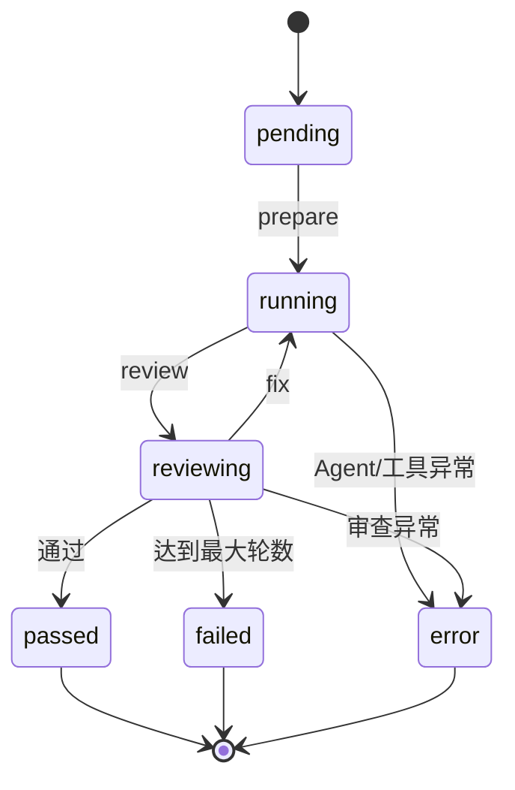

# Design.md — 代码审查 Workflow 设计说明

本文说明 Homework 2 的系统设计：目标、架构、编排、状态与消息、Agent 分工、并行执行、日志、错误处理、可扩展性与测试策略。

---

## 1. 目标与非目标

### 目标

1. 用至少 2 个 Agent 协作完成一条有实际意义的完整流程。
2. 让 Agent 之间可以传递消息、共享状态。
3. 用清晰的控制流把多个 Agent 串起来，并支持条件分支与循环。
4. 产出一个可运行、可演示、可提交的 MVP。
5. 复用 Homework 1 的代码审查能力，而不是从零重写。

### 非目标

- 不做通用低代码 Workflow 平台；
- 不做多租户、权限、任务队列等生产级能力；
- 不做拖拽式流程编辑器（作业中为可选项）；
- 不追求对任意语言都做深度静态分析（当前语法门禁面向 Python）。

---

## 2. 总体架构



分层说明：

| 层 | 文件 | 职责 |
| --- | --- | --- |
| 配置层 | `config.py` | 读取 `.env`、运行参数、离线模式、API Key 校验 |
| 共享模型层 | `state.py` | `WorkflowState`、`AgentMessage`、审查结果结构 |
| 模型接入层 | `llm.py`、`mock_llm.py` | 构建真实/离线模型，统一调用与重试 |
| Agent 层 | `agents/` | 编码、审查、修复三类 Agent |
| 工具层 | `tools/` | 语法检查、复杂度分析、代码执行、文件读取（复用 HW1） |
| 编排层 | `workflow/` | LangGraph 装配、节点、路由、报告、日志 |
| 交互层 | `ui/` | 命令行、Gradio Web、SVG 状态图 |
| 入口 | `main.py` | 转发到 CLI |

---

## 3. Workflow 编排

### 3.1 图结构



图由 `workflow/graph.py` 中的 `build_graph()` 装配：

- 5 个普通节点：`prepare`、`coding`、`review`、`fix`、`finalize`；
- 4 组条件边：入口、编码后、审查后、修复后；
- `review → fix → review` 形成受控循环；
- `finalize` 是唯一汇合点，保证所有路径都能收尾；
- 开启 `pause_before_fix` 时，`compile(interrupt_before=["fix"])` 让图在进入修复节点前暂停，等待人工确认后从同一 `thread_id` 恢复。

### 3.2 节点职责

| 节点 | 输入 | 输出（状态增量） | 产物 |
| --- | --- | --- | --- |
| `prepare` | `task`、`code`、`code_source` | `status`、`messages` | `00_task.md`、`01_input_code.py` |
| `coding` | `task`、`language` | `code`、`history`、`messages` | `10_code_v0.py` |
| `review` | `code`、`task`、`threshold` | `review`、`round`、`reviews`、`messages` | `20_review_vN.md/.json` |
| `fix` | `code`、`review` | `code`、`history`、`diffs`、`messages` | `30_code_fix_vN.py`、`31_diff_vN.txt` |
| `finalize` | 全部状态 | `status`、`final_report`、`messages` | `90_final_code.py`、`90_final_report.md`、`99_state.json` |

每个节点只返回增量，不直接修改完整状态；合并由 LangGraph 完成，日志回调时使用 `merge_update()` 在本地副本上模拟同样的合并逻辑。

### 3.3 路由规则与终止条件

| 判定函数 | 规则 |
| --- | --- |
| `route_entry` | error → finalize；已有代码 → review；否则 → coding |
| `route_after_coding` | error → finalize；成功 → review |
| `route_after_review` | error / passed / round >= max_rounds → finalize；否则 → fix |
| `route_after_fix` | error → finalize；成功 → review |

暂停点不影响路由判定：`route_after_review` 仍返回 `fix`，但开启人工确认时图会在进入 `fix` 之前被 `interrupt_before` 拦截，恢复后继续同一条边。

“通过”由两件事同时决定：

1. `score >= pass_threshold`；
2. `issues` 中不存在 `severity == "critical"`。

该判定在 `review_parser.parse_review()` 中完成，是条件分支的唯一事实来源，避免让 LLM 的自然语言结论直接控制流程。

### 3.4 循环保护

- 最大审查轮数由 `MAX_ROUNDS` / `--rounds` 控制，默认 3，最小 1。
- `review` 节点每执行一次 `round += 1`；`route_after_review` 在轮数耗尽时强制进入 `finalize`。
- LangGraph 的 `recursion_limit` 设为 `max(25, max_rounds * 6 + 10)`，即使路由出现异常也不会无限执行。
- `fix` 节点不增加轮数，避免“修复一次算一轮”造成轮数膨胀；轮数只由审查次数决定。

---

## 4. 共享状态与消息传递

### 4.1 WorkflowState

`WorkflowState` 是节点之间传递数据的唯一通道：

| 字段 | 类型 | 说明 |
| --- | --- | --- |
| `task` | `str` | 自然语言需求 |
| `language` | `str` | 目标语言 |
| `code` | `str` | 当前最新代码 |
| `original_code` | `str` | 用户输入的原始代码（如有） |
| `code_source` | `str` | `task` 或 `file`，决定入口分支 |
| `review` | `ReviewResult \| None` | 最新一轮结构化审查结果 |
| `round` | `int` | 已完成的审查轮数 |
| `max_rounds` | `int` | 轮数上限 |
| `threshold` | `float` | 通过阈值 |
| `status` | `str` | `pending/running/reviewing/awaiting_confirmation/passed/failed/error` |
| `run_dir` | `str` | 本次运行的产物目录 |
| `final_report` | `str` | 最终 Markdown 报告 |
| `pause_before_fix` | `bool` | 是否在每轮修复前暂停，等待人工确认 |
| `offline` | `bool` | 是否离线 Mock 运行（恢复时据此沿用 Mock 模型） |
| `errors` | `list[str]` | 累积错误（reducer 追加） |
| `messages` | `list[AgentMessage]` | 累积协作消息（reducer 追加） |
| `history` | `list[dict]` | 代码版本轨迹（reducer 追加） |
| `reviews` | `list[dict]` | 轻量审查记录（reducer 追加） |
| `diffs` | `list[dict]` | 每轮修复前后的 unified diff 与增删行数（reducer 追加） |

五个列表字段使用 `Annotated[list, operator.add]`，节点只返回新增条目：

```python
messages: Annotated[list[AgentMessage], operator.add]
history: Annotated[list[dict[str, Any]], operator.add]
reviews: Annotated[list[dict[str, Any]], operator.add]
errors: Annotated[list[str], operator.add]
diffs: Annotated[list[dict[str, Any]], operator.add]
```

这样避免了节点之间手工拼接列表，也让 LangGraph 的 `stream_mode="updates"` 更容易合并。

### 4.2 AgentMessage

```python
class AgentMessage(TypedDict):
    timestamp: str
    sender: str
    recipient: str
    kind: str       # task / result / review / fix / pause / resume / error / done
    round: int
    content: str
```

一条真实消息示例：

```json
{
  "timestamp": "2026-10-22T08:48:20+08:00",
  "sender": "review_agent",
  "recipient": "router",
  "kind": "review",
  "round": 1,
  "content": "评分 2.0/10（阈值 8.0），未通过；严重问题 3 个，改进建议 0 个。"
}
```

### 4.3 为什么同时需要“状态”和“消息”

- **状态共享**负责“把数据交给下一个 Agent”：代码、审查结果、轮数都在 `WorkflowState` 中，节点直接读取，不依赖消息解析。
- **消息传递**负责“让协作过程可观察”：记录谁在什么时候把什么结果交给谁，写入 `trace.jsonl`、最终报告第 7 节和 Web 的“Agent 消息”页签。
- 二者分工明确：状态是数据面，消息是协作面。若把大段代码塞进消息，会放大日志与报告体积；若只保留消息，又需要额外解析才能做路由。

消息按角色流转：

```text
system → coding_agent      task
coding_agent → review_agent  result
review_agent → router      review
workflow → user            pause       # 暂停在修复前
workflow → user            resume      # 人工确认后恢复
fix_agent → review_agent   fix
workflow → user            done
```

---

## 5. Agent 设计

### 5.1 角色与输出契约

| Agent | 类 | 输出契约 | 质量门禁 |
| --- | --- | --- | --- |
| 编码 Agent | `CodingAgent` | 只含一个代码块 | 提取代码块 + `ast.parse`，失败重试 1 次 |
| 审查 Agent | `ReviewAgent` | Markdown 报告 + 末尾 JSON | JSON 必须可解析，失败重试 1 次 |
| 修复 Agent | `FixAgent` | 只含一个完整代码块 | 提取代码块 + `ast.parse`，失败重试 1 次 |

三个 Agent 都继承 `BaseAgent`，统一通过 `ask()` 调用 `call_llm`，并写入 `agent_start / agent_end / agent_error` 日志。

### 5.2 Prompt 策略

- **编码 Prompt**：只输出 ```python 代码块；仅标准库；类型标注；边界处理；带 `__main__` 演示。
- **审查 Prompt**：复用 Homework 1 的审查维度（正确性、可读性、性能、安全性、Python 最佳实践）与四段式报告，并在末尾追加机器可读 JSON。
- **修复 Prompt**：输入原始需求、当前代码、评分、问题清单与工具证据；要求输出完整代码而不是 diff。

把“给人看的报告”和“给机器看的 JSON”放在同一份输出中，是为了：

1. 报告可直接作为交付物；
2. JSON 可稳定驱动路由；
3. 只需要一次 LLM 调用，降低时延与成本。

### 5.3 结构化审查结果

```python
class ReviewResult(TypedDict):
    score: float
    passed: bool
    summary: str
    issues: list[ReviewIssue]
    strengths: list[str]
    dimensions: dict[str, float]
    markdown: str
    threshold: float
    evidence: dict[str, str]
```

`review_parser` 做了防御性归一化：

- `severity` 兼容中英文与大小写（`high` → `critical` 等）；
- `line` 兼容数字与带文字的字符串；
- 兼容模型把 `critical` / `suggestions` 拆成独立字段；
- 评分裁剪到 0~10。

这层归一化降低了真实 LLM 输出不稳定对流程的影响。

### 5.4 LLM 调用与重试

`call_llm()` 统一负责：

1. 组装 `SystemMessage + HumanMessage`；
2. 调用模型并提取纯文本（兼容多段 content）；
3. 空内容视为失败；
4. `LLM_RETRIES` 次重试，间隔 `1.5 * attempt` 秒（1.5s、3s、4.5s...）；
5. 记录每次尝试的耗时、字符数、错误。

Agent 级重试与 LLM 级重试是两层不同的机制：前者解决“输出格式不合格”，后者解决“网络/限流故障”。

---

## 6. 并行执行

审查节点需要三类证据，彼此独立：

```python
with ThreadPoolExecutor(max_workers=3) as pool:
    futures = {
        "syntax": pool.submit(check_python_syntax.invoke, {"code": code}),
        "complexity": pool.submit(analyze_complexity.invoke, {"code": code}),
        "execution": pool.submit(run_python_code.invoke, {"code": code}),
    }
```

设计要点：

- 三个工具同时启动，审查总耗时约等于最慢的那个，而不是三者之和；
- 单个工具失败不会中断审查，失败信息会作为证据文本传给 LLM（例如执行超时）；
- 每个工具的结果都写入 `tool_result` 事件，包含字符数与 200 字预览，便于排查。

---

## 7. 执行日志与状态追踪

### 7.1 trace.jsonl

每次运行一个 `trace.jsonl`，逐行追加 JSON，支持运行中实时查看：

| 事件 | 触发点 | 关键字段 |
| --- | --- | --- |
| `workflow_start` | 运行开始 | `task`、`code_source`、`offline`、`model`、`max_rounds`、`threshold`、`pause_before_fix` |
| `node_start` | 节点开始 | `node`、`round`（审查节点） |
| `node_end` | 节点结束 | `node`、`status`、`score`、`passed`、`lines`、`diff`、`added`、`removed` 等 |
| `workflow_pause` | 暂停在修复前 | `round`、`checkpoint` |
| `workflow_resume` | 开始恢复 | `run_dir`、`round` |
| `workflow_resume_checkpoint` | 成功读取检查点 | `round`、`next`（待执行节点）、`checkpoint` |
| `agent_start` / `agent_end` | Agent 调用 LLM 前后 | `node`、`label`、`chars` |
| `agent_error` | Agent 调用异常 | `label`、`error` |
| `llm_call` | LLM 调用成功 | `attempt`、`duration_ms`、`chars` |
| `llm_error` | LLM 调用失败 | `attempt`、`error` |
| `tool_batch_start` / `tool_batch_end` | 并行工具批次 | `node`、`round` |
| `tool_result` | 单个工具完成 | `tool`、`chars`、`preview` |
| `workflow_end` | 正常收尾 | `status`、`rounds` |
| `workflow_crash` | 图级异常 | `error` |

### 7.2 状态追踪的三个视图

1. **CLI**：每个节点结束时打印一行摘要，暂停时提示 `resume` 命令；
2. **Web**：进度条 + SVG 流程图 + 六个页签（报告/代码对比/代码/日志/消息/产物），支持暂停后继续；
3. **文件**：`trace.jsonl`、每轮报告、每轮 diff、最终报告、`99_state.json`、`checkpoints.sqlite`。

`executed_nodes()` 按 `node_start` 首次出现提取实际执行顺序，既用于 SVG 着色，也用于测试断言，确保“条件分支真的跳过了某个节点”。

---

## 8. 错误处理与恢复

### 8.1 四层防线

| 层级 | 位置 | 行为 |
| --- | --- | --- |
| L1 LLM 重试 | `llm.call_llm` | 网络抖动/限流/空响应时指数退避重试 |
| L2 Agent 重试 | `CodingAgent` / `ReviewAgent` / `FixAgent` | 输出格式不合格或语法错误时重新请求，最多 2 次 |
| L3 节点兜底 | `workflow/nodes.py` | 捕获 Agent 异常，写入 `errors` 与 `status=error`，返回增量让图继续 |
| L4 图级兜底 | `run_workflow` | 捕获框架级异常，写 `workflow_crash`，手动调用 `finalize_node` 生成报告 |

关键原则：**任何失败都要留下可读的收尾状态**，而不是把异常直接抛给用户。即使 LLM 完全不可用，也会生成 `90_final_report.md`。

### 8.2 状态机



`finalize` 根据已有状态判定最终值：

- `status == error` → `error`；
- 最后一轮 `review.passed` → `passed`；
- 其他 → `failed`。

### 8.3 人工确认与断点恢复

除“失败可诊断、可收尾”外，本项目还实现了主动的**人机协作暂停点**：

1. `build_graph(..., checkpointer=SqliteSaver, pause_before_fix=True)` 在编译时设置 `interrupt_before=["fix"]`；
2. 每次 `review` 判定需要修复时，图在进入 `fix` 前中断，写 `workflow_pause` 事件、`99_state.json` 与 `checkpoints.sqlite`；
3. CLI 提示 `python main.py resume <run_dir>`；Web 显示“继续修复”按钮；
4. 恢复时以 `thread_id = run_id` 打开同一个 SQLite 检查点，`app.stream(None)` 从 `fix` 继续，不重跑 `prepare / coding / review`；
5. 恢复会读取快照中的 `pause_before_fix` 与 `offline`，离线运行不会意外切到真实 API。

边界：检查点存于单机 SQLite，不跨机器共享；若运行目录被删除，则无法恢复（`99_state.json` 可作为兜底信息，但不能替代 LangGraph 检查点）。

---

## 9. UI 与可视化

### 9.1 CLI

- `demo` 一条命令完成离线演示；
- `run` 支持从需求或已有代码进入；
- `--pause` 在每轮修复前暂停，输出恢复命令；`resume <run_dir>` 从检查点继续；
- 每个节点结束打印摘要，结束时打印状态、评分、轮数、产物路径与 diff 统计；
- `--report` 直接输出完整 Markdown 报告。

### 9.2 Web

Gradio 页面分为输入区与结果区：

- 输入：需求、已有代码路径、语言、最大轮数、阈值、离线开关、修复前人工确认；
- 操作：运行 Workflow；暂停后点击“继续修复（从暂停点恢复）”；
- 结果：SVG 状态图、最终报告、代码对比、最终代码、执行日志表格、Agent 消息 JSON、产物下载。

`_run_click` / `_continue_click` 通过 `on_node` 回调更新进度条，并把状态映射到各个输出组件；暂停时把 `run_dir` 存入 `gr.State`，作为恢复入口。

### 9.3 SVG 流程图

`ui/svg.py` 用内联 SVG 绘制五个节点：

- 已执行：绿色；
- 出错：红色；
- 未执行：灰色；
- 底部显示实际执行顺序，例如 `prepare → coding → review → fix → review → finalize`。

它不是拖拽式编排器，而是“运行状态可视化”：让评审者一眼看出条件分支是否生效、循环跑了几轮、哪个节点失败。

---

## 10. 复用 Homework 1 的设计

| 复用项 | 具体做法 |
| --- | --- |
| 审查工具 | 直接复用 `syntax_checker`、`complexity_analyzer`、`code_executor`，保持 `@tool` 接口 |
| 文件读取 | 复用 `file_reader` 的编码兼容与大小限制 |
| 审查维度 | 沿用正确性/可读性/性能/安全性/最佳实践 |
| 报告格式 | 沿用严重问题/改进建议/优点/评分四段式，追加 JSON |
| 重试机制 | 沿用指数退避思路，抽到 `llm.call_llm` |
| UI 风格 | CLI 与 Gradio 的交互方式保持一致 |

没有直接复用 Homework 1 的 `CodeReviewAgent` 类，因为它是“单 Agent + 工具循环”的形态，与 Workflow 节点需要的“一次确定性调用 + 结构化输出”不同。复用的是它的**能力**（工具、Prompt、审查标准），而不是它的控制流。这是有意的设计取舍。

---

## 11. 可扩展性

### 11.1 新增一个 Agent（例如安全审查 Agent）

1. 在 `agents/` 新建 `security_agent.py`，继承 `BaseAgent`，实现 `run()`；
2. 在 `prompts.py` 增加系统提示词与任务提示词；
3. 在 `state.py` 增加所需字段（如 `security_review`）；
4. 在 `workflow/nodes.py` 增加 `security_node` 与对应路由；
5. 在 `workflow/graph.py` `add_node` 并连接边；
6. 在 `workflow/report.py` 增加展示章节。

由于节点只返回状态增量，新增节点不需要修改其他节点的实现。

### 11.2 新增分支或循环

路由函数都是纯函数（状态 → 节点名），新增判定只需：

```python
def route_after_review(state):
    if state.get("security_review", {}).get("critical"):
        return "security_fix"
    ...
```

再在 `add_conditional_edges` 的映射中注册目标节点即可。

### 11.3 替换模型或接入本地模型

只需改 `.env` 的 `LLM_BASE_URL` / `LLM_MODEL`，或实现一个带 `invoke(messages)` 的模型对象传给 `run_workflow(model=...)`。离线 `MockLLM` 就是这一接口的最小实现，也证明了模型层的可替换性。

### 11.4 持久化与断点续跑

已实现最小可用的持久化恢复：

1. 使用 LangGraph `SqliteSaver`，每个运行目录一个 `checkpoints.sqlite`；
2. `thread_id` 使用 `run_dir.name`（即 `run_id`），保证恢复时能定位到同一条线程；
3. `resume_workflow()` 读取 `99_state.json` 判断离线模式，再从 `app.get_state(config)` 取检查点继续；
4. 暂停点由 `interrupt_before=["fix"]` 定义，后续可扩展为任意节点（如审查后、审批后）。

若要多机协作或长期保存，可将 `SqliteSaver` 替换为 Postgres/Redis 检查点，节点与路由代码无需修改。

---

## 12. 测试策略

`tests/test_workflow_offline.py` 使用 `MockLLM`，不依赖网络与 API Key。

| 测试 | 验证点 |
| --- | --- |
| `test_full_loop_passes_after_fix` | 完整循环：编码 → 审查未通过 → 修复 → 复审通过；产物、Diff 与消息齐全；审查执行 2 次 |
| `test_existing_code_skips_coding` | 入口条件分支：已有代码时节点序列为 `prepare → review → finalize` |
| `test_max_rounds_stops_loop` | 循环保护：阈值 10、最多 2 轮时以 `failed` 收尾 |
| `test_llm_failure_becomes_error_state` | 错误处理：模型持续抛异常时进入 `error`，仍生成报告 |
| `test_pause_and_resume` | 人工确认：首轮后停在 `awaiting_confirmation`，检查点存在；`resume_workflow` 后通过且生成 Diff |
| `test_conditional_routing` | 路由函数在各种状态下的返回值 |
| `ParsingTest`（5 个） | 代码块提取、语法门禁、审查 JSON 解析、缺少 JSON 报错、JSON 对象提取 |

运行：

```bash
python -m unittest discover -s tests -v
python -m ruff check .
```

设计上的取舍：测试重点放在**编排行为**而不是 LLM 文案。Mock 让“第一轮失败、第二轮通过”可复现，从而稳定验证循环与分支。

---

## 13. 已知限制与后续改进

| 限制 | 影响 | 改进方向 |
| --- | --- | --- |
| 离线 Mock 是确定性规则，不是真实推理 | 离线演示不能代表真实审查质量 | 用真实 LLM 跑同一流程；Mock 仅用于流程自测 |
| 代码执行隔离较弱 | 仅子进程 + 超时，不适合不可信代码 | 容器/沙箱、资源限制、网络隔离 |
| 检查点存于单机 SQLite | 不能跨机器恢复 | 切换 Postgres/Redis 检查点后端 |
| 无拖拽式编排编辑器 | 编排需改代码 | 基于图定义生成可编辑 UI |
| 语法门禁仅覆盖 Python | 其他语言只能靠 LLM 审查 | 接入 tree-sitter / 各语言 linter |
| 真实 LLM 评分存在波动 | 同一代码多次评分可能不同 | 多次采样取中位数、固定 temperature、增加规则校验 |
| 消息只做记录，不做异步总线 | Agent 不能主动互相唤醒 | 引入消息队列/事件驱动编排 |

---

## 14. 自评（对照评分维度）

| 维度 | 权重 | 本项目的对应实现 |
| --- | --- | --- |
| 流程完整性 | 40% | 5 节点覆盖准备、编码、审查、修复、收尾；入口分支、审查分支、修复循环、终止条件、人工确认暂停点齐全；任意路径都能生成报告 |
| Agent 协作 | 30% | 3 个 Agent 分工明确；共享状态 + 结构化消息；审查结果驱动修复；暂停/恢复消息与协作记录可回溯 |
| 可扩展性 | 20% | 分层架构；节点只返回增量；路由为纯函数；模型可替换；检查点后端可替换；新增 Agent 的步骤明确 |
| 文档 | 10% | README 覆盖安装、配置、运行、暂停恢复、Diff、产物、FAQ；Design 覆盖架构、状态、消息、路由、错误处理、断点恢复、测试与限制 |

---

## 15. 关键设计决策摘要

1. **用状态而不是消息传数据**：大段代码与结构化结果放 `WorkflowState`，消息只记录协作事实，避免日志膨胀。
2. **用 JSON 而不是自然语言驱动路由**：审查输出同时包含 Markdown 与 JSON，路由只读 JSON，降低不确定性。
3. **轮数只由审查次数决定**：修复不算一轮，避免循环计数失真。
4. **所有失败都收尾**：节点兜底 + 图级兜底，保证任何情况下都有报告与日志。
5. **Mock 与真实模型同接口**：离线模式验证的是编排，而不是替代真实推理。
6. **复用能力而非复用控制流**：Homework 1 的工具与审查标准被复用，单 Agent 循环被改造成 Workflow 节点。
7. **修复必须留下 Diff**：每次修复生成 unified diff 并写入报告与 Web，评审者能直接判断 Agent 改了什么。
8. **关键修复可人工把关**：`interrupt_before=["fix"]` + SQLite 检查点，让自动循环在需要时变成人机协作。
