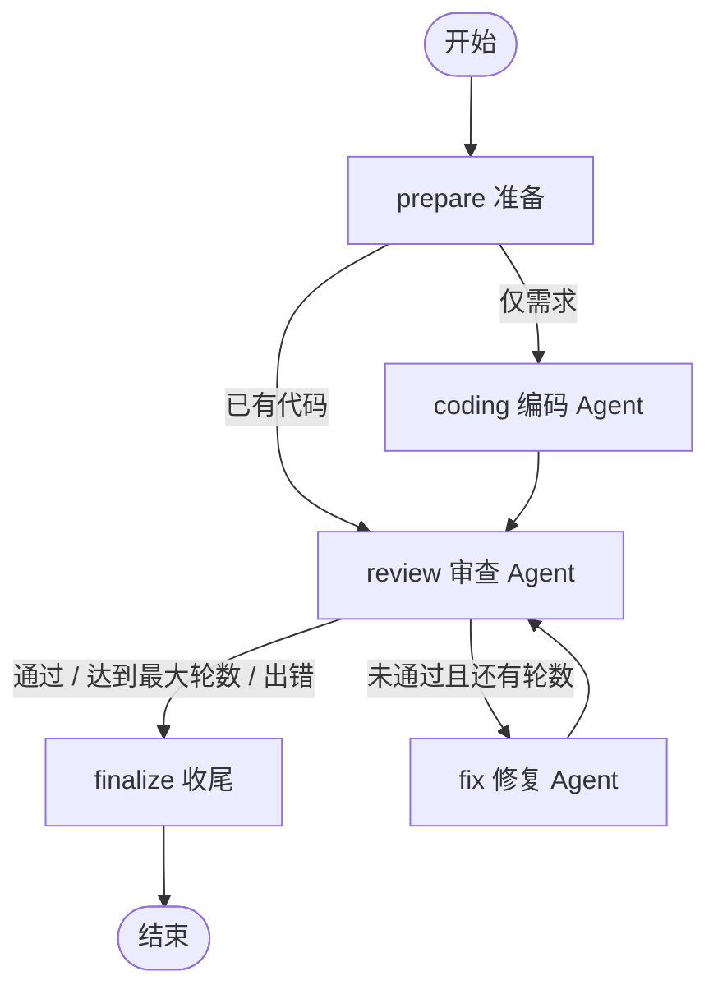

# 代码审查 Workflow（Homework 2）

> 在 Homework 1 的代码审查 Agent 基础上，用 **LangGraph** 编排 **编码 Agent → 审查 Agent → 修复 Agent** 的完整协作流水线：审查不通过会自动进入修复循环，直到通过或达到最大轮数。

项目同时提供命令行与 Gradio Web 界面，并支持**离线 Mock 模式**：没有 API Key 也能完整跑通节点、条件分支、修复循环、日志与可视化。

---

## 1. 工作流一览



一次典型运行：

```text
prepare → coding → review(2.0 分，未通过) → fix → review(9.5 分，通过) → finalize
```

三个 Agent 的职责：

| Agent | 节点 | 输入 | 输出 |
| --- | --- | --- | --- |
| 编码 Agent | `coding` | 自然语言需求 | 完整可运行代码 |
| 审查 Agent | `review` | 当前代码 + 三个工具的真实证据 | Markdown 报告 + JSON 结论（评分/问题） |
| 修复 Agent | `fix` | 当前代码 + 结构化问题清单 | 完整修复代码，回到审查节点复审 |

---

## 2. 作业要求对照

### 必须实现

| 要求 | 实现方式 |
| --- | --- |
| 至少 2 个 Agent 协作完成完整流程 | 3 个 Agent：`coding_agent` / `review_agent` / `fix_agent`，覆盖“生成 → 审查 → 修复”全流程 |
| Agent 间消息传递或状态共享 | `WorkflowState` 共享状态 + `AgentMessage` 结构化消息；消息写入报告、`trace.jsonl` 与 Web 界面 |
| 基本顺序流程控制 | LangGraph `StateGraph` 顺序边 + 条件边，五个节点按规则推进 |
| MVP 可运行 | 离线 `demo` 一键跑通；10 个离线测试；CLI 与 Web 双入口 |

### 推荐实现

| 要求 | 实现方式 |
| --- | --- |
| 条件分支 | 入口分支（已有代码跳过编码）；审查后分支（通过 / 修复 / 终止） |
| 循环 | `review → fix → review`，由 `max_rounds` 防止死循环 |
| 并行执行 | 审查节点的语法检查、复杂度分析、代码执行三个工具并行运行 |
| 可视化 Workflow 编排界面（可选） | Web 内置内联 SVG 流程图，实时展示已执行/出错/未执行节点与真实执行顺序 |
| 执行日志与状态追踪 | `trace.jsonl` 记录节点、LLM 调用、工具调用、错误；每轮报告与最终状态全部归档 |
| 错误处理与恢复 | Agent 重试、节点兜底、图级崩溃兜底三层处理；异常也会生成报告 |
| 复用项目 1 的 Agent | 复用作业1的 3 个审查工具、审查维度与四段式报告、LLM 重试机制、文件读取工具 |

> 说明：本项目的可视化是“运行状态可视化 + Web 操作台”，编排关系由 `workflow/graph.py` 代码定义，未实现拖拽式 Workflow 编辑器（作业中为可选项）。

---

## 3. 快速开始

### 3.1 环境与依赖

- Python 3.10+（开发环境为 Python 3.14）
- 安装依赖：

```bash
pip install -r requirements.txt
```

主要依赖：`langgraph`、`langchain` / `langchain-openai`、`gradio`、`python-dotenv`、`ruff`。

### 3.2 配置 LLM（真实模式）

复制模板并填写 Key：

```bash
copy .env.example .env      # Windows
# cp .env.example .env      # macOS / Linux
```

```env
LLM_BASE_URL=https://api.deepseek.com/v1
LLM_API_KEY=sk-你的真实Key
LLM_MODEL=deepseek-chat
```

任何 OpenAI 兼容服务都可以接入：

| 服务 | `LLM_BASE_URL` | `LLM_MODEL` 示例 |
| --- | --- | --- |
| DeepSeek | `https://api.deepseek.com/v1` | `deepseek-chat` |
| 通义千问（兼容模式） | `https://dashscope.aliyuncs.com/compatible-mode/v1` | `qwen-plus` |
| OpenAI | `https://api.openai.com/v1` | `gpt-4o-mini` |
| 本地 Ollama | `http://localhost:11434/v1` | `qwen2.5:7b`（Key 可随便填） |

### 3.3 离线跑通（无需 API Key）

```bash
python main.py demo --report
```

预期输出（Mock 确定性结果）：

```text
[prepare] 任务已接收，代码来源：自然语言需求；下一节点：coding_agent。
[coding] 初版代码已生成（23 行，2 个函数），提交给审查 Agent。
[review] 第 1 轮 评分 2.0/10（阈值 8.0），未通过；严重问题 3 个，改进建议 0 个。
[fix] 第 1 轮修复完成（20 行，2 个函数），提交复审。
[review] 第 2 轮 评分 9.5/10（阈值 8.0），通过；严重问题 0 个，改进建议 0 个。
[finalize] Workflow 结束，最终状态：passed，审查轮数：2。
```

`--report` 会在终端打印完整最终报告；不加则只打印进度与产物路径。

### 3.4 从需求开始（真实 LLM）

```bash
python main.py run -t "实现一个 LRU 缓存，支持 get/put，容量满时淘汰最久未使用项" --report
```

### 3.5 从已有代码开始（真实 LLM）

提供 `-f` 后会跳过编码 Agent，直接从审查开始：

```bash
python main.py run -f examples/bad_code.py --report
```

### 3.6 启动 Web 界面

```bash
python main.py web
```

浏览器打开 `http://127.0.0.1:7860`。左侧填写需求或代码文件路径，右侧可查看流程图、最终报告、最终代码、执行日志、Agent 消息与产物下载。

没有 API Key 时界面会默认勾选“离线 Mock 模式”；也可以显式启动：

```bash
python main.py web --offline --port 7860
```

---

## 4. 命令行参数

| 命令 | 说明 |
| --- | --- |
| `python main.py demo` | 离线演示：跑通“编码 → 审查 → 修复 → 复审”循环 |
| `python main.py run -t "需求"` | 从自然语言需求开始 |
| `python main.py run -f 文件路径` | 从已有代码开始（跳过编码 Agent） |
| `python main.py web` | 启动 Gradio 界面 |

`run` 通用参数：

| 参数 | 说明 |
| --- | --- |
| `-t, --task` | 自然语言需求 |
| `-f, --file` | 已有代码文件 |
| `--language` | 目标语言，默认 `python` |
| `--rounds` | 最大审查轮数（含首轮） |
| `--threshold` | 通过阈值（0~10） |
| `--offline` | 使用离线 Mock 模型 |
| `--report` | 运行结束后打印完整报告 |

配置也可写入 `.env`：`MAX_ROUNDS`、`PASS_THRESHOLD`、`CODE_EXEC_TIMEOUT`、`LLM_*`。

---

## 5. 执行流程与路由规则

| 节点 | 关键动作 |
| --- | --- |
| `prepare` | 写任务说明与输入代码；决定进入编码还是直接审查；输入为空时报错 |
| `coding` | 调用编码 Agent，提取代码块并做 AST 语法门禁；失败重试一次 |
| `review` | 并行调用 3 个工具收集证据，再由 LLM 输出报告 + JSON；更新轮数 |
| `fix` | 把问题清单交给修复 Agent，产出完整代码；随后回到 `review` |
| `finalize` | 判定最终状态，生成报告，落盘最终代码、状态快照与结束日志 |

路由规则（`workflow/nodes.py`）：

| 位置 | 条件 | 去向 |
| --- | --- | --- |
| `prepare` | 状态为 error | `finalize` |
| `prepare` | 已有代码（`code_source=file` 且代码非空） | `review` |
| `prepare` | 仅需求 | `coding` |
| `coding` | 出错 | `finalize` |
| `coding` | 正常 | `review` |
| `review` | 出错 / 通过 / 达到最大轮数 | `finalize` |
| `review` | 未通过且还有轮数 | `fix` |
| `fix` | 出错 | `finalize` |
| `fix` | 正常 | `review`（循环） |

通过判定：`score >= 阈值` **且** 不存在 `critical` 问题。

---

## 6. 运行产物

每次运行都会在 `runs/YYYYMMDD-HHMMSS-xxxxxx/` 下归档：

| 文件 | 内容 |
| --- | --- |
| `00_task.md` | 本次任务说明 |
| `01_input_code.py` | 用户提供的原始代码（如有） |
| `10_code_v0.py` | 编码 Agent 生成的初版代码 |
| `20_review_vN.md` / `.json` | 第 N 轮审查报告与结构化结果 |
| `30_code_fix_vN.py` | 第 N 轮修复后的代码 |
| `90_final_code.py` | 最终代码 |
| `90_final_report.md` | 最终报告（需求、评分轨迹、审查报告、错误、代码、协作记录、产物清单） |
| `99_state.json` | 工作流最终状态快照 |
| `trace.jsonl` | 完整执行日志（JSONL，逐行追加） |

`runs/` 已加入 `.gitignore`，不会提交到仓库。

---

## 7. 目录结构

```text
code-review-workflow/
├── main.py                    # 统一入口（转发到 ui.cli）
├── config.py                  # .env 读取、运行参数、离线模式
├── state.py                   # WorkflowState 与 AgentMessage
├── llm.py                     # ChatOpenAI 构建、统一调用、指数退避重试
├── mock_llm.py                # 离线 Mock 模型（仅自测/演示）
├── prompts.py                 # 三个 Agent 的 Prompt
├── review_parser.py           # 审查 Markdown + JSON 解析、通过判定
├── code_utils.py              # 代码块提取、AST 语法门禁、JSON 提取
├── agents/
│   ├── base.py                # Agent 基类（统一 LLM 调用与日志）
│   ├── coding_agent.py        # 编码 Agent
│   ├── review_agent.py        # 审查 Agent（并行工具调用）
│   └── fix_agent.py           # 修复 Agent
├── workflow/
│   ├── graph.py               # LangGraph 装配与运行入口
│   ├── nodes.py               # 五个节点与条件路由
│   ├── report.py              # 最终报告生成
│   └── trace.py               # JSONL 执行日志
├── tools/                     # 复用 Homework 1 的工具
│   ├── file_reader.py
│   ├── syntax_checker.py
│   ├── code_executor.py
│   └── complexity_analyzer.py
├── ui/
│   ├── cli.py                 # 命令行入口
│   ├── web.py                 # Gradio 界面
│   └── svg.py                 # 内联 SVG 工作流可视化
├── examples/bad_code.py       # 故意埋坑的示例代码
├── tests/test_workflow_offline.py
├── .env.example
├── requirements.txt
├── pyproject.toml
├── README.md
└── Design.md
```

---

## 8. 测试与代码检查

```bash
python -m unittest discover -s tests -v
python -m ruff check .
```

当前结果：

- 10 个离线测试全部通过；
- `ruff` 输出 `All checks passed!`。

测试覆盖：完整修复循环、已有代码跳过编码、最大轮数终止、LLM 故障进入 error 状态、条件路由、代码块/JSON 解析、语法门禁。

---

## 9. 与 Homework 1 的复用关系

| Homework 1 内容 | 在 Homework 2 中的用途 |
| --- | --- |
| `check_python_syntax` | 审查节点收集语法证据；编码/修复 Agent 的语法门禁 |
| `analyze_complexity` | 审查节点收集复杂度证据 |
| `run_python_code` | 审查节点实际执行代码，复现运行时 Bug |
| `read_code_file` / `read_text_file` | CLI 与 Web 读取用户指定的代码文件 |
| 审查 Prompt 的维度与四段式报告 | 扩展为“Markdown + JSON”，JSON 直接驱动条件分支 |
| LLM 指数退避重试 | 统一封装在 `llm.call_llm` |
| Gradio / CLI 交互风格 | 扩展为 Workflow 操作台 |

Homework 1 的 `CodeReviewAgent` 是“单 Agent 调工具做审查”；Homework 2 将其审查能力封装为 Workflow 中的一个节点，并新增编码与修复两个 Agent 及编排逻辑。

---

## 10. 常见问题

**没有 API Key 能运行吗？**
可以。`python main.py demo` 或 `python main.py web --offline` 会使用 `MockLLM`，流程、分支、循环、日志都是真实的，只是推理结果由确定性规则生成。

**离线模式和真实模式有什么区别？**
离线模式只替换模型客户端；节点、状态合并、条件边、循环、工具调用、报告生成完全相同。真实模式还需要配置 `.env`。

**为什么运行结束状态是 `failed`？**
说明达到最大轮数时仍未通过（评分不足或仍存在 critical 问题）。查看 `20_review_vN.md` 与 `trace.jsonl` 定位原因，也可以调大 `--rounds` 或调整 `--threshold`。

**运行过程中报错怎么办？**
先看运行目录的 `trace.jsonl`，按 `level=error` 筛选；节点级错误会写入 `state.errors` 并出现在最终报告第 4 节。

**生成的代码会被执行吗？**
审查节点会在子进程中运行代码（默认 5 秒超时），用于复现运行时 Bug。当前隔离仅限独立进程与超时，**不要在生产环境直接执行不可信的模型生成代码**。

**支持其他语言吗？**
流程支持传入 `--language`，但 AST 语法门禁只对 Python 生效；其他语言会跳过语法门禁，仍可做 LLM 审查。

---

## 11. 设计文档

架构、状态模型、消息传递、路由、错误处理与扩展方式的详细说明见 [Design.md](Design.md)。
